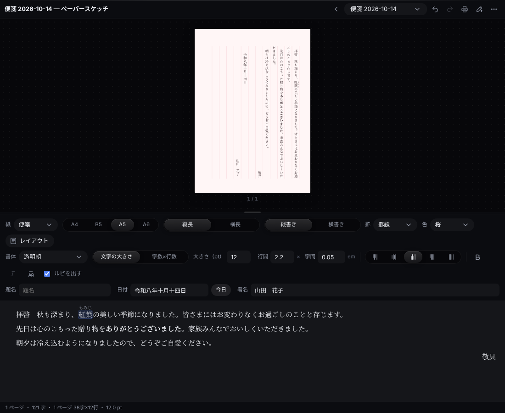
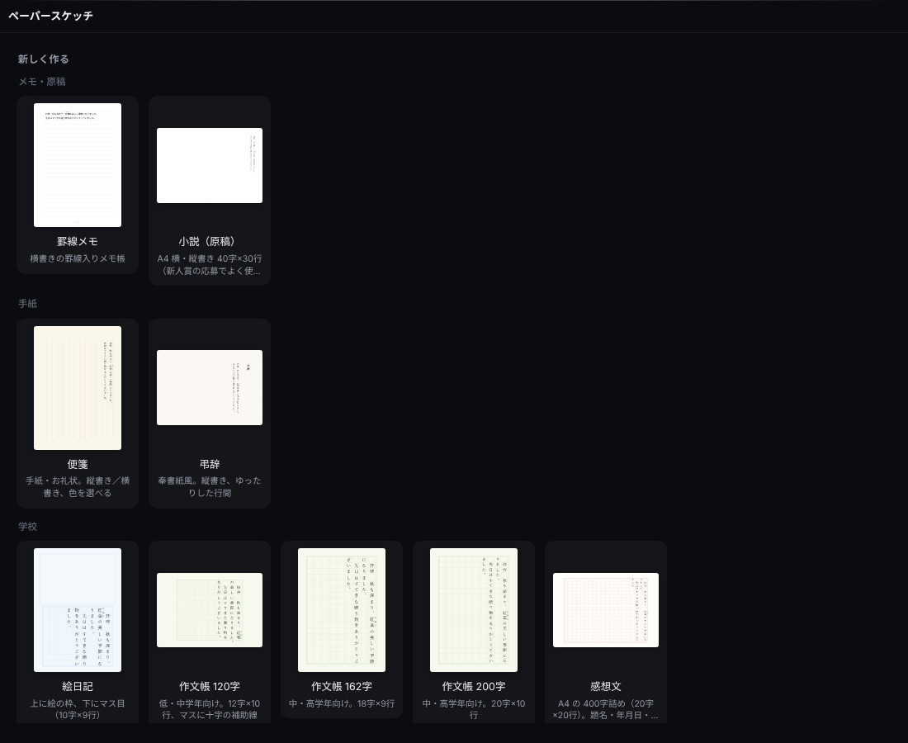

<p align="center"></p>

# ペーパースケッチ（Paper Sketch）

<p align="center"><a href="README.md">English</a> · <b>日本語</b></p>

Windows のデスクトップの端に置く作業台 **[Hub](https://github.com/satosugarforwork44x-lang/desktop-hub)** の拡張アプリです。
便箋・弔辞・作文帳・感想文・文庫本などの「紙」を選んで、**縦書きでも横書きでも**文章を書き、そのまま印刷・PDF にできます。
ルビ・揃え・太字・斜体・行間・字間は Word と同じ感覚で使え、校正は AI（Claude・ChatGPT・Gemini）に頼めます。



> ライセンス: [PolyForm Noncommercial 1.0.0](LICENSE)（個人・営利目的でない利用は自由）

## 作った理由

手紙・お礼状・子どもの作文・弔辞。どれも「紙の形」が決まっているのに、Word で作ると思いのほか手間がかかります。

- **縦書きの原稿用紙が作りにくい。** マス目と字をそろえるだけで一仕事です
- **ルビの付け方がわかりにくい。** 子ども向けの文章ではよく使うのに、メニューの奥にあります
- **文章そのものは、ほかのアプリや AI と行き来したい。** iPhone のメモで下書きして、AI に校正してもらって、紙に印刷する

そこでペーパースケッチは、**紙を選ぶ → 書く → 印刷する** だけにしぼりました。

- **紙は 12 種類から選ぶだけ。** 判型・縦横・罫線・マス目・余白・色はひな形に入っていて、あとから変えられます
- **打ち込み欄はいつも横書き。** 書きやすい横書きで打ち、上の紙（縦書き）がすぐ変わります
- **本文は 1 つのテキスト。** 書式は `**太字**`・`｜漢字《かんじ》` のような短い記号で持つので、AI に渡しても崩れません

## UX で決めたこと

| 決めたこと | 理由 |
|---|---|
| **上に紙、下に打ち込み欄** | 縦書きの紙の上で直接打つと、カーソルの動きが分かりにくくなります。横書きで打って、結果を紙で見る形にしました |
| **組版は自前で、1 字ずつ位置を決める** | ブラウザの折り返しに任せず、字数×行数・マス目に合わせて置きます。プレビュー・印刷・PDF がまったく同じになります |
| **書式は 3 つの単位** | 文書全体（書体・大きさ・行間・字間）/ 段落（揃え）/ 文字（太字・斜体・ルビ）。段落の途中で書体を変える機能は入れません（保存の形が Word 並みに複雑になるため） |
| **縦書きでは「左揃え」が「天付き」** | 揃えのボタンの絵と名前が、縦書き・横書きで切り替わります。署名の地付きにそのまま使えます |
| **縦書きでは斜体を使えない** | 日本語の書体には斜体がなく、縦書きで傾けると崩れるため。データは残るので、横書きに戻すと出ます |
| **禁則は日本語の組版のきまり** | 「、。」は行末にぶら下げ、行頭に来てはいけない字（」ー っ など）は前の字と一緒に送ります |
| **書き出した txt は、読み込むと元どおり** | txt の 1 行目に紙の設定を入れます。本文だけが欲しいとき（iPhone のメモ・ほかのアプリ）は「本文だけを txt に」を使います |
| **上書きしない** | 書き出しは `名前 (2).txt`。編集はその場で保存し、外で（Claude が）書き換えても Ctrl+Z で戻せます |

## 紙のひな形



| 種類 | ひな形 |
|---|---|
| メモ・原稿 | 罫線メモ（A5 横書き）、小説（A4 横・縦書き 40字×30行） |
| 手紙 | 便箋（A5、縦書き／横書き、色 7 種）、弔辞（奉書紙風、A4 横・縦書き） |
| 学校 | 絵日記（絵の枠＋マス目）、作文帳 120字（12×10、十字の補助線）・162字（18×9）・200字（20×10）、感想文（A4 の 400字詰め） |
| 本 | 文庫本 A6（縦書き 38字×16行 ＝ 1 ページ 約600字）、A5 学術書・教科書（横書き 36×28）、A5 文芸誌・総合誌（縦書き 2 段組） |

どのひな形も、判型（A4・B5・A5・A6）・縦長／横長・縦書き／横書き・罫（なし・罫線・マス目）・余白・段組・ページ番号を変えられます。

## できること

| 機能 | 内容 |
|---|---|
| **書体** | PC に入っている書体だけを出します（游明朝・游ゴシック・BIZ UD・UD デジタル教科書体・HG正楷書体 など） |
| **大きさ・行間・字間** | pt・倍・em で指定。または「字数×行数」を決めて、大きさを自動で合わせる |
| **揃え** | 左（天付き）・中央・右（地付き）・両端揃え・均等割り付け。`Ctrl+L / E / R / J`、均等割り付けは `Ctrl+Shift+J` |
| **太字・斜体** | `Ctrl+B` / `Ctrl+I`（斜体は横書きのみ） |
| **ルビ** | 字を選んで「ルビ」ボタン。付いたルビはクリックで直す・外す。紙に出すかどうかを切り替えられる |
| **題名・日付・署名** | 紙の種類に合わせて置きます（手紙は本文の後に日付と署名、作文は 1 行目に題名・2 行目に名前）。「今日」で、縦書きは「令和八年十月十四日」、横書きは「2026年10月14日」 |
| **印刷・PDF** | `Ctrl+P`。プリンターで「Microsoft Print to PDF」を選ぶと PDF |
| **読み込み** | `.txt`（UTF-8・Shift_JIS）・`.paper.json` をパネルに落とす |
| **書き出し** | txt（読み込むと元どおり）・本文だけの txt（ルビは「漢字（かんじ）」）・`.paper.json` |
| **AI で校正** | 「校正を頼む文をコピー」→ ChatGPT・Gemini に貼る → 直った文章を「貼って置き換える」。Claude なら Hub から直接ファイルを直せます |
| **日本語と英語** | パネルはどちらの言語でも使えます |

## 使い始める

**Hub 0.8 以上**が必要です。必須の Python パッケージはありません（画面は HTML、保存は標準ライブラリ）。

1. このリポジトリを、Hub のモジュールのフォルダに **`paper` という名前で**置きます（フォルダ名はモジュールの id と同じにする）
   ```bat
   git clone https://github.com/satosugarforwork44x-lang/paper-sketch "%LOCALAPPDATA%\Hub\modules\paper"
   ```
2. Hub を再起動すると、バーに **ペーパースケッチ** が出ます。紙を選んで書き始めてください。
   文書はフォルダ窓の置き場所の下の **`Paper Sketch`** フォルダにしまうので、そのままフォルダ窓にもなります
3. （任意）Claude に校正してもらうとき: Hub の設定（⚙）→ Claude との連携 → `Paper Sketch` を **読み書き** に。
   Claude は保存先の `PAPER_FORMAT.md` を読んで、書式の記号を残したまま本文を直します

## 文書の形

`<名前>.paper.json` は、紙の設定と本文（記号つきのテキスト）だけの短い JSON です。詳しくは [PAPER_FORMAT.md](PAPER_FORMAT.md)。

```text
　拝啓　秋も深まり、｜紅葉《もみじ》の美しい季節になりました。
　先日は**ありがとうございました**。
>>敬具
```

| 記号 | 意味 |
|---|---|
| 行頭の `>>` `><` `<>` `==` | 右揃え（地付き）・中央・均等割り付け・両端揃え |
| `**…**` `*…*` | 太字・斜体 |
| `｜親文字《ルビ》` `漢字《かんじ》` | ルビ |

## ファイル

| ファイル | 役目 |
|---|---|
| `api.py` | 作る・開く・保存・読み込み・書き出し（Python 標準ライブラリだけ） |
| `templates.json` | 紙のひな形・判型・色 |
| `ui/layout.js` | 組版（行の分け方・禁則・揃え・ページ分け）。DOM を使わないので node でテストできる |
| `ui/render.js` | 組んだページを mm 単位の DOM にする（プレビューと印刷で共通） |
| `ui/markup.js` | 本文の記号の読み書き |
| `ui/editor.js` | 打ち込み欄（書式付き）と本文の行き来 |
| `ui/panel.js` | 画面 |

## テスト

```bat
py -m unittest discover -s tests
node --test tests/layout.test.mjs
```

## これから

- 絵の挿入（手紙・招待状の飾り、絵日記の絵）
- 縦中横（縦書きの中の 2 桁の数字を横に並べる）
