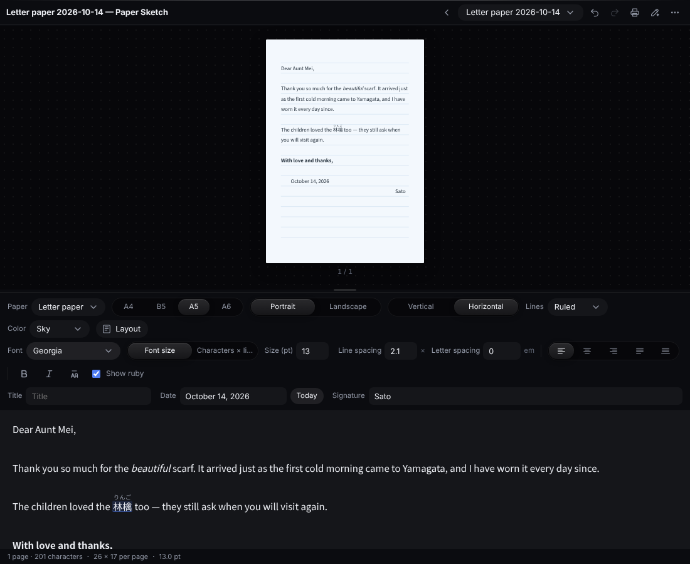
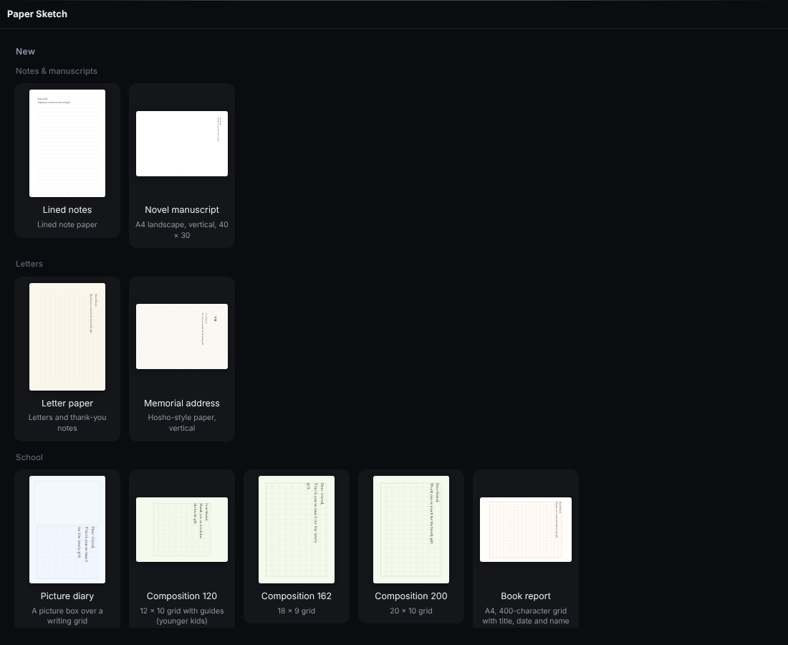

<p align="center"></p>

# Paper Sketch

<p align="center"><b>English</b> · <a href="README.ja.md">日本語</a></p>

An extension for **[Hub](https://github.com/satosugarforwork44x-lang/desktop-hub)**, a workbench that sits at the edge of the Windows desktop.
Pick a paper — letter paper, a memorial address, a school composition grid, a pocket book page — write in **vertical or horizontal** Japanese (or English), and print it or save it as a PDF.
Ruby (furigana), alignment, bold, italic, line and letter spacing work the way they do in Word, **pictures, shapes and text boxes** can be placed on the paper, and proofreading goes to AI (Claude, ChatGPT, Gemini).
For novelists there is a **per-work glossary** (characters, places, unique readings) that adds ruby every time or only at a term's first appearance in each chapter.



> License: [PolyForm Noncommercial 1.0.0](LICENSE) (free for personal and non-commercial use)

## Why

Letters, thank-you notes, a child's composition, a memorial address — each has a fixed paper format, yet making one in Word takes surprisingly long.

- **Vertical manuscript grids are hard to build.** Lining characters up with squares is a job in itself
- **Ruby is buried in menus,** even though texts for children use it all the time
- **The text itself should travel** between apps and AI: draft on an iPhone, have AI proofread it, print it on paper

So Paper Sketch is just **pick a paper → write → print**.

- **Twelve papers to start from.** Size, direction, rules, squares, margins and color come with the paper and can be changed later
- **You always type horizontally.** The page above — vertical or not — updates as you write
- **The text is one plain string.** Formatting is kept as short marks like `**bold**` and `｜漢字《かんじ》`, so it survives a round trip through AI

## UX decisions

| Decision | Why |
|---|---|
| **Paper on top, typing below** | Typing directly on a vertical page makes the caret hard to follow. Type horizontally, see the result on paper |
| **Own typesetting, one character at a time** | No browser line wrapping: characters are placed on the chars × lines / square grid, so preview, print and PDF are identical |
| **Three levels of formatting** | Document (font, size, line and letter spacing) / paragraph (alignment) / character (bold, italic, ruby). No font changes mid-paragraph — that would make the file format as complex as Word's |
| **In vertical writing, “left” becomes “top”** | Alignment icons and names switch with the writing direction. “Bottom” is exactly what a signature needs |
| **No italic in vertical writing** | Japanese fonts have no italics and slanted vertical text breaks. The data is kept and shows again in horizontal writing |
| **Japanese line-breaking rules** | 、。 hang at the line end; characters that must not start a line (」ー っ …) take the previous character with them |
| **An exported .txt reopens exactly as it was** | The first line holds the paper settings. For other apps (iPhone Notes…) use “Export text only” |
| **Pictures and shapes sit on the paper** | They are kept by position on the page (mm), apart from the text flow, so editing the text never moves them and print matches the screen. Text does not wrap around them (“Behind text” turns them into a backdrop) |
| **Pictures are stored once, by hash** | Imported pictures are copied to `Paper Sketch\_images` under a hash of their content. One copy per picture, and an exported document still points to the same pictures |
| **One glossary per work, ruby added at typesetting** | Novels are usually split into chapters, so a work has one glossary (`<work>.dict.json`) shared by its chapters. The text just says 東雲; the typesetter adds the ruby. Change a reading once and every chapter follows |
| **No automatic “ordinary reading” detection** | That would need a morphological dictionary and make the tool heavy, so each term is registered as “every time” or “first only”. Unique readings default to “every time” |
| **Nothing is overwritten** | Exports become `name (2).txt`. Edits save in place, and changes made outside (by Claude) can be undone with Ctrl+Z |

## Papers



| Group | Papers |
|---|---|
| Notes & manuscripts | Lined notes (A5, horizontal), novel manuscript (A4 landscape, vertical 40 × 30) |
| Letters | Letter paper (A5, vertical or horizontal, 7 colors), memorial address (hosho-style, A4 landscape, vertical) |
| School | Picture diary (picture box + grid), compositions of 120 (12 × 10, guide crosses), 162 (18 × 9) and 200 (20 × 10) characters, book report (A4, 400-character grid) |
| Books | Pocket book A6 (vertical 38 × 16 ≈ 600 characters a page), A5 textbook (horizontal 36 × 28), A5 magazine (vertical, two tiers) |

Every paper's size (A4, B5, A5, A6), orientation, writing direction, rules (plain, ruled, squares), margins, columns and page numbers can be changed.

## Features

| Feature | Details |
|---|---|
| **Fonts** | Only fonts installed on the PC are listed (Yu Mincho, Yu Gothic, BIZ UD, UD Digi Kyokasho, HG Seikaisho…) |
| **Size and spacing** | pt / × / em — or set characters × lines and let the size follow |
| **Alignment** | Left (top), center, right (bottom), justify, distribute. `Ctrl+L / E / R / J`, distribute `Ctrl+Shift+J` |
| **Bold, italic** | `Ctrl+B` / `Ctrl+I` (italic in horizontal writing only) |
| **Ruby** | Select text, press Ruby. Click a ruby to edit or remove it. Show or hide ruby on paper |
| **Title, date, signature** | Placed the way each paper expects (letters: date and signature after the text; compositions: title on line 1, name on line 2). “Today” writes 令和八年十月十四日 in vertical writing |
| **Pictures** | The picture button, paste (`Ctrl+V`) or drop from the PC. PNG, JPEG, GIF, WebP, BMP. Resize from the corners (keeps proportions, `Shift` for free), opacity, angle, behind text |
| **Shapes and text boxes** | Box, rounded box, circle, line, arrow. Line color and width, fill. Text inside a shape (bold and ruby too) with size, color, vertical writing and alignment |
| **Working with them** | Click to select, drag to move, arrow keys 1 mm (`Shift` 5 mm), `Ctrl+D` duplicate, `Delete` remove, forward / backward. Everything undoes with `Ctrl+Z` |
| **Work glossary** | Pick (or create) a work in the glossary panel. Register people, places, terms and unique readings with ruby every time, first time per chapter, or never. Select text and right-click → Add to glossary. Click a term to insert it. Shows how often each term appears in the chapter |
| **Same ruby only once** | Hand-written ruby that repeats (same text and reading) is shown only the first time |
| **Print / PDF** | `Ctrl+P`. Choose “Microsoft Print to PDF” to save a PDF |
| **Open** | Drop a `.txt` (UTF-8 or Shift_JIS) or `.paper.json` on the panel |
| **Export** | .txt that reopens as is, text only (.txt, ruby as 漢字（かんじ）), `.paper.json` |
| **Proofread with AI** | “Copy a proofreading request” → paste into ChatGPT / Gemini → “Paste the corrected text”. The request includes the glossary so unique readings are not “corrected”. Claude can edit the file directly through Hub, and can build the glossary from your chapters |
| **Japanese and English** | The panel works in either language |

## Getting started

Requires **Hub 0.8 or later**. No Python packages are needed (the UI is HTML, saving uses the standard library).

1. Put this repository in Hub's module folder **named `paper`** (the folder name must match the module id)
   ```bat
   git clone https://github.com/satosugarforwork44x-lang/paper-sketch "%LOCALAPPDATA%\Hub\modules\paper"
   ```
2. Restart Hub and **Paper Sketch** appears on the bar. Pick a paper and start writing.
   Documents live in a **`Paper Sketch`** folder under the folder panels' location, so it also works as a folder panel
3. (Optional) To let Claude proofread: Hub settings (⚙) → Claude → set `Paper Sketch` to **read & write**.
   Claude reads `PAPER_FORMAT.md` in that folder and keeps the formatting marks while fixing the text

## File format

`<name>.paper.json` is a short JSON with the paper settings, the text (a string with marks) and the things placed on the paper. See [PAPER_FORMAT.md](PAPER_FORMAT.md).

```text
　拝啓　秋も深まり、｜紅葉《もみじ》の美しい季節になりました。
　先日は**ありがとうございました**。
>>敬具
```

| Mark | Meaning |
|---|---|
| `>>` `><` `<>` `==` at the start of a line | Right (bottom), center, distribute, justify |
| `**…**` `*…*` | Bold, italic |
| `｜base《ruby》` `漢字《かんじ》` | Ruby |

## Files

| File | Role |
|---|---|
| `api.py` | Create, open, save, import, export (Python standard library only) |
| `templates.json` | Papers, sizes and colors |
| `ui/layout.js` | Typesetting (line breaking, kinsoku, alignment, pagination). No DOM, so it is tested with node |
| `ui/render.js` | Turns a laid-out page into DOM in millimetres (shared by preview and print) |
| `ui/markup.js` | Reads and writes the formatting marks |
| `ui/editor.js` | The formatted typing area ↔ the text |
| `ui/terms.js` | The work glossary: list, register, click to insert |
| `ui/objects.js` | Selecting, moving, resizing and setting up pictures, shapes and text boxes |
| `ui/panel.js` | The panel |

## Tests

```bat
py -m unittest discover -s tests
node --test tests/layout.test.mjs
```

## Next

- Tate-chu-yoko (two-digit numbers set horizontally inside vertical text)
